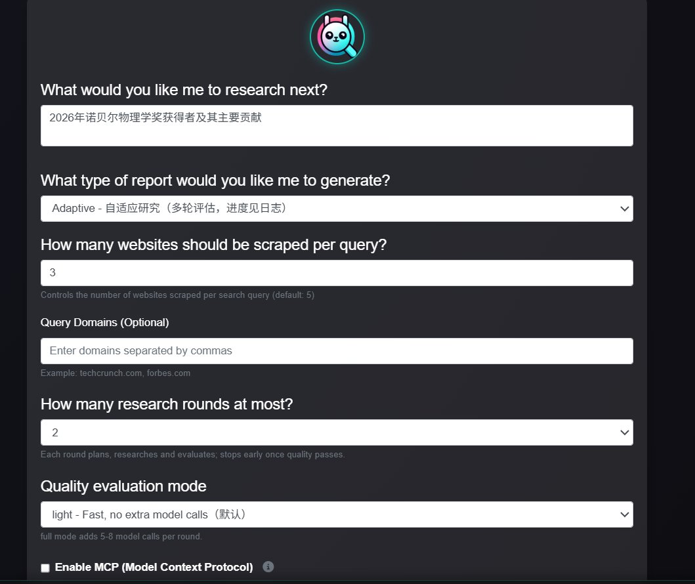
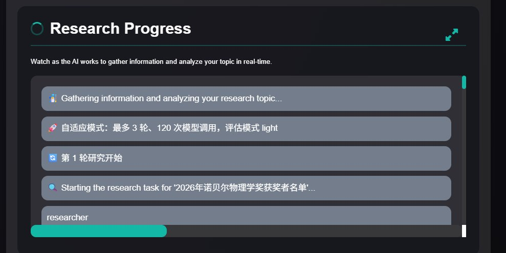
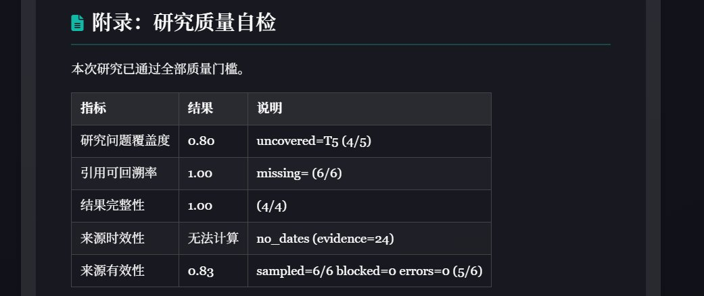
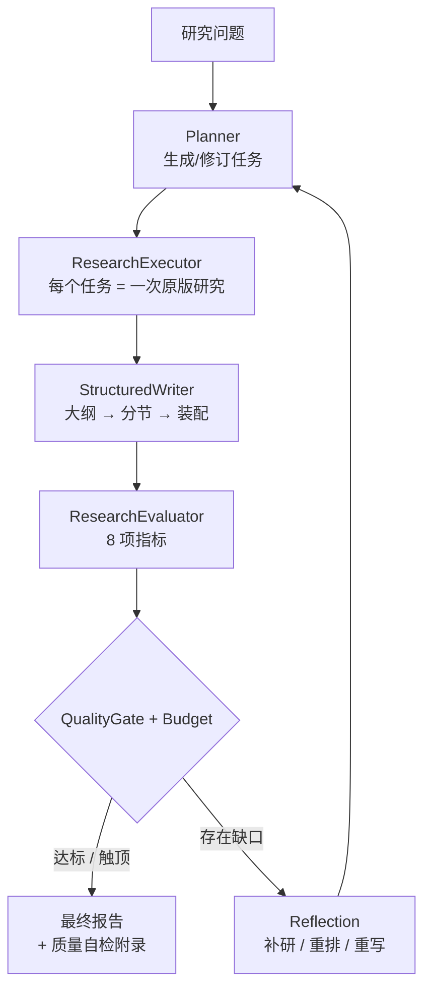

# Adaptive & Reliable Research Agent

> 基于 [GPT Researcher](https://github.com/assafelovic/gpt-researcher) 的自适应、可评估研究代理（Fork）。
>
> Python 包版本：`0.17.0+adaptive.1` ｜ Git 迭代标签：`adaptive-v1.3.1`

本项目保留原版的检索、抓取、压缩、写作能力，并在外面新增一层
“计划 → 执行 → 评估 → 反思 → 终止”的自适应研究循环。
原版入口保持不变；只有显式使用 `--adaptive` 或网页报告类型选择 **Adaptive** 时，才进入自适应流程。

## 界面与运行过程

### 1. 选择 Adaptive，表单自动切换

选中 `Adaptive - 自适应研究` 后，原来的“语气 / 来源”两项会隐藏，替换为
“最多轮次 / 评估模式”；“每查询抓取站点数”和 “Query Domains”保留，并且
**真正作用于自适应检索**（见下方“网页控件一览”）。



### 2. 日志区显示轮次、子任务与指标

启动时会把本轮实际生效的参数打进日志，例如：

```text
🚀 自适应模式：最多 2 轮、120 次模型调用；每查询抓取 3 个站点；域名 不限；评估模式 light
🔄 第 1 轮研究开始
```

之后每轮结束会输出新增证据数与四项指标，并在最终给出停止原因与成本估算。



### 3. 报告附录显示质量自检

达标时附录只保留一行结论 + 指标表；未达标时会展开 5 段式缺口说明
（停止原因、未达标指标、未解决任务、已知薄弱点、建议下一步）。



### 4. 网页控件一览

| 表单字段 | 原版模式 | Adaptive 模式 | 是否真正生效 |
|---|---|---|---|
| 语气 Tone | 显示 | 隐藏 | 否（自适应写作固定客观语气） |
| 来源 Report Source | 显示 | 隐藏 | 否（自适应只做 Web 调研） |
| 每查询抓取站点数 | 显示 | 显示 | **是**（每个子研究都使用该值） |
| Query Domains | 显示 | 显示 | **是**（限定检索域名） |
| 最多轮次 | — | 显示（1~5，默认 3） | **是** |
| 评估模式 | — | 显示（light / full） | **是** |

> 站点数建议保持 3~5：调到 2 会明显减少证据量（实测一轮约 19 条，默认约 30~40 条），
> 更容易触发补研。`full` 评估模式每轮会多 5~8 次模型调用。

## 与原版的区别

| 维度 | 原版 | 本项目 |
|---|---|---|
| 控制流 | 线性流水线，跑完即止 | 外层轮次循环，评估驱动下一步 |
| 计划 | 一次性生成 3 条子查询 | `SubTask` 对象 + 计划版本 + 缺口增补 |
| 中间产物 | `context: str` | `Evidence[]` + `Claim[]`，可定位到来源片段 |
| 质量评估 | 无在线评估 | 8 项指标 + 质量门，每轮计算 |
| 反思修正 | 无（deep 模式有追问下钻） | supplement / replan / rewrite / finish / abort |
| 终止 | 流程自然结束 | 质量达标、预算触顶、连续无进展 |
| 预算 | 只记录美元成本 | 轮次、调用次数、token、秒、美元五类上限 |
| 状态 | 实例属性，结束即丢 | `state.json` + 每轮报告版本，可回放 |
| 失败语义 | 检索失败仍写报告 | 任务级失败 + 三态 + 报告内强制披露缺口 |
| 报告结构 | 一次 LLM 整篇 | 大纲 → 分节 → 装配 → 净化；质量自检附录 |

## 工作原理



每个子任务仍然是 `GPTResearcher.conduct_research()`：
检索器、抓取器、压缩器、去重逻辑全部复用原版。
新增的只是编排、评估、预算和状态记录。

## 快速开始

### 环境

要求 Python 3.12+（本项目在 3.13.2 上验证）。

```powershell
python -m venv .venv
.venv\Scripts\activate
pip install -r requirements.txt
copy .env.example .env
```

### 配置

在 `.env` 中至少设置：

```dotenv
SMART_LLM=deepseek:deepseek-chat
FAST_LLM=deepseek:deepseek-chat
STRATEGIC_LLM=deepseek:deepseek-chat
RETRIEVER=tavily
TAVILY_API_KEY=your_key_here
```

自适应配置全部有默认值，不设置也能运行；完整列表见 `.env.example` 与下文。

### 运行

```powershell
# 原版：一次性研究报告
python cli.py --report_type research_report "你的研究问题"

# 改造版：自适应研究循环
python cli.py --adaptive --adaptive_rounds 2 "你的研究问题"

# 网页：报告类型选择 “Adaptive - 自适应研究”
python main.py
# http://127.0.0.1:8000/  →  选 Adaptive 后填写轮次/评估模式即可
```

> 网页表单会在选中 Adaptive 时自动切换：隐藏“语气/来源”，显示“最多轮次/评估模式”，
> 同时保留并生效“每查询抓取站点数”和 “Query Domains”。切回其它类型立即恢复原样。

> 早期版本曾提供 `/adaptive-ui` 独立调试页；最终交付版已移除，只保留原网页入口。

## 配置项

| 类别 | 键 | 默认 |
|---|---|---|
| 开关/预算 | `ADAPTIVE_ENABLED` | `false`（预留项；实际入口是 `--adaptive` / `report_type=adaptive`） |
| | `ADAPTIVE_MAX_ROUNDS` | `3` |
| | `ADAPTIVE_MAX_LLM_CALLS` | `120` |
| | `ADAPTIVE_MAX_TOKENS` | `300000` |
| | `ADAPTIVE_MAX_SECONDS` | `900` |
| | `ADAPTIVE_MAX_COST_USD` | `0.15` |
| 计划/执行 | `ADAPTIVE_MAX_TASKS` | `6` |
| | `ADAPTIVE_PLAN_TASKS` | `5` |
| | `ADAPTIVE_MAX_TASKS_PER_ROUND` | `4` |
| | `ADAPTIVE_CONCURRENCY` | `3` |
| 评估 | `ADAPTIVE_EVAL_MODE` | `light` |
| | `ADAPTIVE_MIN_COVERAGE` | `0.70` |
| | `ADAPTIVE_MIN_CITATION_MATCH` | `0.80` |
| | `ADAPTIVE_MIN_COMPLETENESS` | `0.90` |
| | `ADAPTIVE_MIN_SUPPORT_RATE` | `0.85` |
| | `ADAPTIVE_MAX_CONFLICT` | `0.10` |
| 其他 | `ADAPTIVE_NO_PROGRESS_ROUNDS` | `2` |
| | `ADAPTIVE_VALIDITY_SAMPLE` | `20` |
| | `ADAPTIVE_FRESHNESS_MONTHS` | `24` |
| | `ADAPTIVE_STATE_DIR` | `outputs/adaptive` |

## 产物与状态

```text
outputs/adaptive/<run_id>/
├── state.json          # 计划、证据、结论、每轮指标、预算、决策
├── report_v1.md ...    # 每轮报告草稿
└── final_report.md     # 最终报告（含质量自检附录）
```

运行终态：

- `completed`：质量门全部满足，`stop_reason=quality_met`；
- `partial`：预算/无进展/结构问题导致停止，报告附 5 段式缺口说明；
- `failed`：规划失败、报告无法生成等硬失败。

## 质量评估与停止

| 指标 | 成本 | 门槛 |
|---|---|---|
| `coverage` 研究问题覆盖度 | 零 | ≥ 0.70 |
| `citation_match_url` 引用可回溯 | 零 | ≥ 0.80 |
| `completeness` 结构完整性 | 零 | ≥ 0.90 |
| `source_validity` 来源有效性 | HTTP 抽样 | 仅展示 |
| `source_freshness` 来源时效性 | 零 | 仅展示 |
| `support_rate` 结论证据支持率 | LLM | ≥ 0.85（full） |
| `citation_match_semantic` 引用支撑结论 | LLM | 仅展示（full） |
| `conflict_rate` 结论冲突率 | LLM 抽样 | ≤ 0.10（full） |

停止原因包括：`quality_met`、`max_rounds`、`max_llm_calls`、`max_tokens`、
`max_seconds`、`max_cost`、`no_progress`、`planner_exhausted`、`error`。

## 对照实验

同一查询、同一配置下的一次实测（非统计显著性实验）：

| 指标 | 原版 | 改造版 |
|---|---|---|
| 轮次 | 1 | 2 |
| 成本（估算） | $0.0111 | $0.0627（约 5.6×） |
| 耗时 | ~40 秒 | 139.8 秒（约 3.5×） |
| 质量自检 | 无 | coverage 1.00 / 引用可回溯 1.00 / 完整性 1.00 |

> 成本按内置价目表估算，DeepSeek 实际价格低一个数量级，表中金额应理解为上界。
> 更完整的实验记录见 [`docs/改造方案/14_对照实验报告.md`](docs/改造方案/14_对照实验报告.md)。

## 测试

```powershell
# 改造新增测试（按名称筛选）
python -m pytest tests -k "adaptive" -q

# 全量
python -m pytest tests/ -q
```

改造新增 172 个用例；全量收集 1080 个用例（含原项目既有测试）。
全量测试中存在两个原项目既有失败，与本次改造无关；
详见 [`docs/改造方案/15_使用说明与已知问题.md`](docs/改造方案/15_使用说明与已知问题.md)。

## 已知限制

- 自适应网页模式只做 Web 检索：Tone 与 Sources 在选中 Adaptive 时会隐藏；
  `每查询抓取站点数` 与 `Query Domains` 已生效；MCP 配置暂不传入自适应流程。
- 写作语言只区分中文/英文；韩文等其他语言会回退为英文报告。
- `ADAPTIVE_ENABLED` 是预留配置，代码中未读取；实际开关是 `--adaptive` / `report_type=adaptive`。
- `light` 模式的覆盖度是词面启发式，中文同义改写可能漏判，属于保守下界。
- 模型调用/token 计数可能偏低，预算触发时间可能晚于预期。
- 成本估算使用 OpenAI 价目表，DeepSeek 场景下 `max_cost_usd` 可能过早触发。
- 来源时效性指标目前通常为 `None`（抓取阶段未回填发布日期）。
- 写作模型不可用时，最终报告会降级为证据摘要，并强制标记为 `partial`。

## 目录结构

```text
gpt_researcher/adaptive/        # 自适应核心：状态、计划、执行、评估、反思、预算、写作、报告
backend/report_type/adaptive_report/  # 原网页 Adaptive 报告适配器
docs/改造方案/                  # 设计、实验、使用说明
docs/images/adaptive/           # 运行截图（随版本更新）
docs/releases/                  # 各版本发布说明（可粘到 GitHub Release）
tests/test_adaptive_*.py        # 改造功能测试
```

## 许可证与致谢

本项目基于 Assaf Elovic 的
[GPT Researcher](https://github.com/assafelovic/gpt-researcher)（Apache License 2.0）修改。

原始版权声明与许可证保留在 [`LICENSE`](LICENSE) 中；改造部分由 zrt09 维护。
本项目不是 GPT Researcher 官方项目，也不代表原作者的背书。
